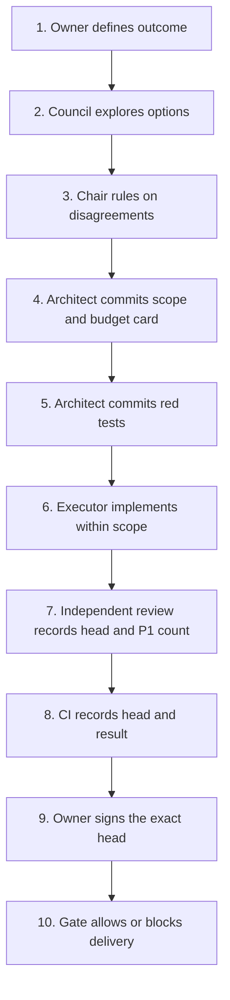

# Multi-agent delivery playbook

One human Owner can delegate software implementation to AI agents while keeping
scope, review, and release decisions tied to evidence. This small, synthetic
Python repository makes that workflow inspectable: the architect commits the
card and red tests first, the executor implements within a fixed budget, and a
local gate blocks delivery unless review, CI, and Owner signoff reference the
exact implementation commit.



## Run it

Python 3.11+ and Git are required. The runtime uses only the standard library;
pytest is a development dependency. In an environment with pytest installed:

```sh
pip install -e . && python -m playbook demo && pytest
```

For a fresh environment, install the test extra with `pip install -e '.[test]'`.
The demo works offline, creates disposable Git repositories, checks exact code
sets for eight scenarios, prints a table, and removes its temporary files.
It performs no network calls, push, merge, or deployment.

## What gets blocked

| Scenario | Expected result |
| --- | --- |
| Valid scope and current evidence | ALLOW |
| Executor edits tests or the card | EXECUTOR_TOUCHED_TESTS |
| Change outside allowed globs | PATH_VIOLATION |
| File or line budget exceeded | BUDGET_EXCEEDED |
| Owner signs an older commit | SIGNOFF_STALE |
| Review references an older commit | REVIEW_STALE |
| CI fails | CI_FAILED |
| Tests committed after implementation | RED_TESTS_NOT_FIRST |

The gate also checks the first card commit, missing or malformed evidence,
open P1 findings, CI freshness, and Owner identity. Returned codes are sorted;
an empty list is the only ALLOW result. Missing or ambiguous commit role lines
produce `ROLE_MISSING`. Binary implementation changes block the line budget
because their size cannot be measured as added and deleted text lines.

## Roles

| Role | Responsibility |
| --- | --- |
| Owner | Defines the outcome and signs the reviewed commit. |
| Architect agent | Defines scope and budget, writes red tests, reviews implementation. |
| Executor agent | Implements within the card, runs checks, commits with `Role: executor`. |

The first commit after the supplied base contains exactly
`.delivery/<task>.md`; the second is an architect commit containing only tests.
The card defines `task`, `allowed_paths`, `max_files`, and `max_lines` in simple
front matter. Paths use Python `fnmatch` globs. Budgets count unique changed
implementation paths and cumulative added plus deleted lines across commits,
so rewriting and reverting work still consumes the line budget. The task card
and tests are excluded from budgets. Tests and delivery cards are protected
from executor changes.

`playbook.gate.evaluate(repo, base, head, evidence)` accepts evidence shaped as:

```python
evidence = {
    "review": {"head": head, "p1": 0},
    "ci": {"head": head, "status": "pass"},
    "signoff": {"head": head, "by": "owner"},
}
```

Evidence is caller-supplied: this example checks structure and commit identity,
not signatures or reviewer authentication. A production integration must obtain
these records from trusted systems. ALLOW is a local decision; publication
still belongs to the Owner.

See [the synthetic cache council](docs/council-example.md) and its
[validated JSON record](docs/council-example.json) for independent first-round
positions, anonymized second-round positions, a devil's advocate, and rulings.

## Publication scan

```sh
python scripts/public_scan.py /path/to/deny-list.txt
python scripts/public_scan.py /path/to/deny-list.txt --root /path/to/repository
```

The positional UTF-8 deny-list contains one literal term per line; matching is
case-insensitive. The default root is this repository. The scanner reports file
and line numbers without echoing matched content and exits 1 on findings.
It detects IPv4 addresses, emails outside RFC 2606 reserved example domains
(`example.com`, `example.org`, `example.net`, `*.example`, `*.invalid`), and deny-list
terms. It skips Git metadata, the local virtual environment, Python/pytest
caches, root-level `codex.log` and `codex.pid`, symlinks, binary files, and the
deny-list itself. File access errors
remain errors rather than clean scan results.

## Verification

Run `.venv/bin/python -m pytest -q` (33 tests) and
`.venv/bin/python -m playbook demo` before delivery.
CI runs the demo and pytest on Ubuntu with Python 3.11. All examples and scenario
repositories use synthetic data.
